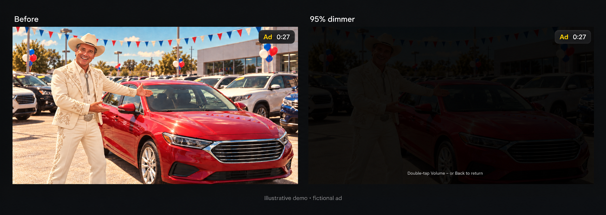

# Ad Dimmer

**Make streaming ads less distracting with a shortcut on your Android TV remote.**

Press your shortcut to darken the screen while keeping the ad countdown visible. Press it again when you’re ready to return.

Includes ready-to-use masks for Prime Video and HBO Max, with adjustable layouts for other streaming apps. Optional Sonos support mutes and restores sound too.

Free and open source. Made for Android TV devices, including TVs, projectors, and streaming boxes.

**[Download Ad Dimmer](https://github.com/stevenchu/ad-dimmer/releases/download/v0.4.0/AdDimmer.apk)** · [Installation help](docs/SETUP.md) · [Report a problem](https://github.com/stevenchu/ad-dimmer/issues)

*Illustrative demo using an AI-generated fictional ad. [Actual projector screenshot](docs/SCREENSHOTS.md).*

## Set it up

**Want help installing?** Share this repository with your AI assistant and ask it to guide you through setup on your Android TV. An assistant with access to your computer can also help install the app. [Start with the AI installation guide](docs/AI-INSTALL.md).

1. **Install the app** on your Android TV device. [Need help?](docs/SETUP.md)
2. **Open Ad Dimmer** from your Apps list. Use **Picture** to set darkness and **Advanced** to adjust the timer opening.
3. **Enable Ad Dimmer remote shortcut** in Android's Accessibility settings.
4. Under **Shortcut**, open **Change shortcut**, try a 90-second temporary mapping, then confirm it works. Nothing is assigned until you choose it.

No paid app, account, root, or firmware change required. Disable other remote-button remappers to avoid conflicts.

Normal volume control is immediate. Single-press replacement shows a warning; Home, Back, and essential navigation are protected.

## Your controls

| Remote button | What happens |
| --- | --- |
| Your confirmed shortcut | Dim / restore the picture |
| Back while dimmed | Restore the picture |
| Left or Right while dimmed | Switch the timer preset |
| Volume Up while dimmed | Restore the picture and raise volume |
| Tap or hold Volume Down (default) | Normal immediate volume control |

[Shortcut safety and recovery](docs/SHORTCUTS.md) explains temporary tests and what happens to normal button actions.

## Make it yours

- Change the darkness; the default is **95%**.
- Move or resize the timer opening—or hide it entirely.
- **Automatic app-aware masks** — Detects whether you're using HBO Max or Prime Video and automatically selects the correct mask, keeping the ad countdown visible while dimming the rest of the screen. You can also save a layout for each app or choose a mask manually.
- Optionally connect **Sonos** to mute and restore sound too. Other audio outputs are not currently controlled.

## Before you install

**You trigger it yourself.** Ad Dimmer does not detect or skip ads. Playback is intended to continue underneath; press the shortcut again when the ad ends.

This is an **experimental release** for Android TV. The bundled timer openings were calibrated on an Android 11 XGIMI Halo+ with Prime Video and HBO Max. Other layouts may need adjustments in **Advanced**. Optional audio was tested with a Sonos Arc Ultra.

**Privacy by design** — Uses only the active app's identity to select the appropriate mask, without accessing viewing content. It does not send viewing history anywhere. Accessibility also handles remote buttons. Optional Sonos control stays on your home network. [Privacy](PRIVACY.md) · [Known limits and testing](docs/VERIFICATION.md)

## Help it grow

Tried it on another device or streaming app? [Share what worked](https://github.com/stevenchu/ad-dimmer/issues/new?template=compatibility.md).

[Contribute](CONTRIBUTING.md) · [Build from source](BUILDING.md) · [Preset foundation](docs/PRESETS.md) · [Test checklist](docs/QA.md)

MIT licensed. Independent project; not affiliated with Amazon, Google, XGIMI, or Sonos.
