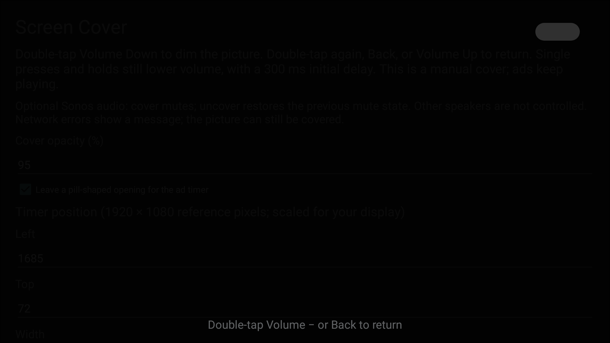

# What has been verified

## v0.2.0 — preset foundation

On the same Android 11 Halo+ and Arc Ultra setup, a separate QA build verified:

- An actual Prime Video window event selects the Prime preset.
- Own/system event filtering preserves the Prime identity.
- Switching to Android TV Settings while covered removes the cover and restores the prior Sonos mute state.
- A synthetic custom app's 55% preset remains separate from Prime's 95% preset.
- Manual selection and return to automatic selection resolve the intended profile.
- Saved custom/Prime presets survive process and service restart.
- Unit tests cover ignored/null/duplicate events, unknown-app fallback, custom selection, manual override, and invalid configuration boundaries.

The custom identifier was simulated. No additional streaming service is certified by those tests. The updated personal build is for a Prime Video pilot; the physical-remote/ad-playback and full-device-reboot checklist in [QA.md](QA.md) still requires user validation.

## v0.1.0 — October 29, 2026

Test device: original XGIMI Halo+ (2023), Android 11/API 30, 1920 × 1080 output. Audio: Sonos Arc Ultra on the home network, connected to the projector through HDMI ARC.

### Community build checks

- Configuration tests pass for private IPv4 ranges, rejected public/malformed addresses, and timer-geometry boundaries.
- APK builds with JDK 17 / Android SDK 35; APK signature verification passes.
- Native settings screen renders on the TV; scrolling exposes geometry and audio settings.
- Accessibility service binds and a 95% dimmer with a pill-shaped opening renders over the app.
- Cover-only mode leaves the speaker's mute state unchanged.
- With a configured speaker, covering sets verified Sonos mute=true; uncovering restores verified mute=false when originally unmuted.
- If originally muted, cover/uncover leaves verified mute=true.
- A malformed/empty audio destination reports failure and does not trap the user in the visual cover.
- Temporary QA service was removed and the original service/mute state restored after testing.

The device tests used a separately identified diagnostic build of the same app source, with a shell-only receiver to trigger preview and editable test preferences. That receiver and debuggable flag are absent from the distributed APK. These tests verify overlay and audio paths, not Bluetooth gesture timing.

This screenshot uses the app’s own settings screen as the background; it contains no private viewing content or network address.

### Evidence from the original prototype

The original local version was used with a physical Bluetooth remote and Prime Video. User feedback confirmed that double-tap showed the cover; photos guided the timer opening. Direct Sonos control replaced an unreliable projector mute toggle. Prime Video stayed resumed and reported PLAYING beneath the cover. Its position report stayed zero, so software reports alone did not prove frame progression or ad completion.

### Still needs community testing

- Public build with physical remote gestures during actual ads, including rapid repeated toggles.
- The full settings flow using only a TV D-pad and on-screen keyboard; rendering is checked, but not every input path.
- Long-held volume, reboot persistence, service disable/re-enable, interrupted networking, and crash/recovery across other firmware.
- Non-XGIMI devices, non-Sonos audio, other Sonos models, other streaming apps, and newer Android versions.
- Exact timer fit on different layouts, video aspect ratios, and resolutions.

No claim of universal compatibility, automatic ad recognition, live blur, or guaranteed playback continuation is made.
