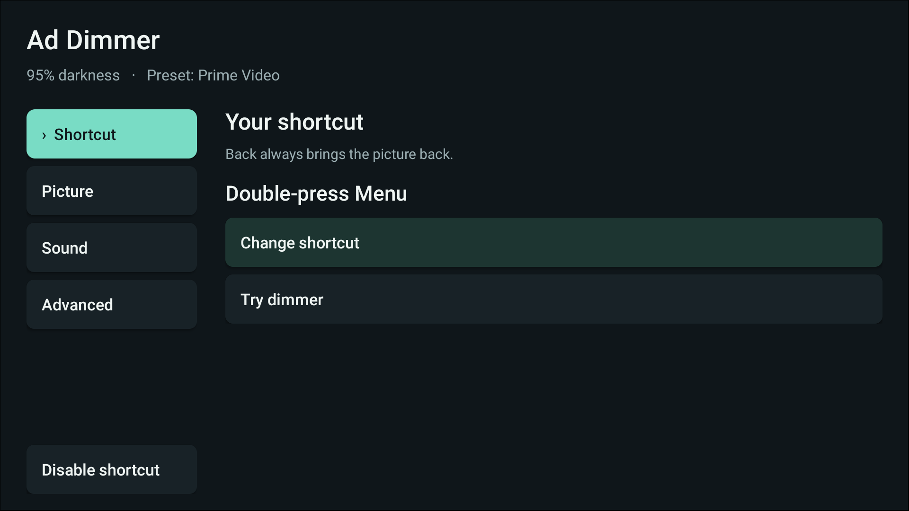
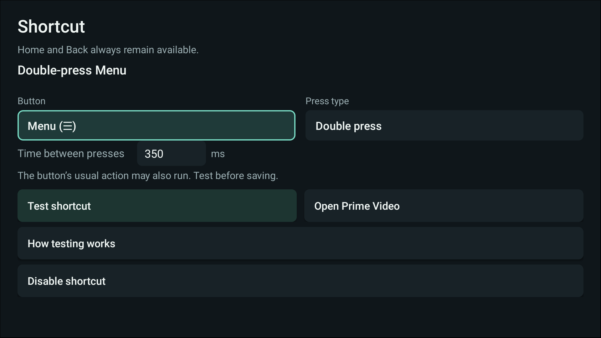
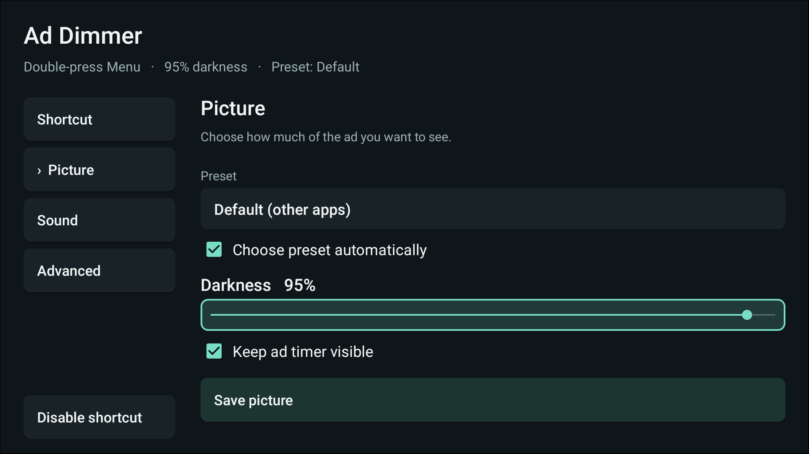
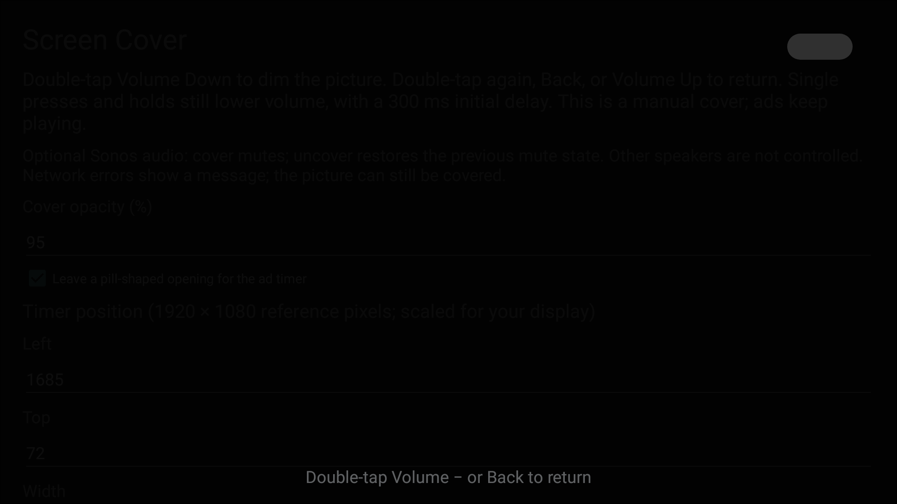

# What has been verified

## v0.5.1 — combined Android and Sonos control

Tested on 2026-11-21 with the Android 11 Halo+ and Sonos Arc Ultra over HDMI ARC.

- Android volume changes initially produced later HDMI unmute/volume feedback. A one-second settling approach worked audibly, but the owner requested less delay. The final path uses the AOSP internal HDMI-origin volume flag to suppress forwarding, with delayed mute checks and an automatically learned settling fallback for devices that still override it. The flag’s forwarding behavior is visible in the [Android 11 AudioService source](https://android.googlesource.com/platform/prebuilts/fullsdk/sources/android-30/+/refs/heads/androidx-room-release/com/android/server/audio/AudioService.java).
- The final implementation reads Sonos mute and volume concurrently before changing audio. Sustained combined cycles kept Android at zero and Sonos muted, then restored the original Android level and exact Sonos volume and mute state. An initially muted speaker stayed muted.
- A deliberately invalid Sonos configuration exercised the failure path while the Android volume-zero attempt still ran. The test restored the real connection afterward.
- Actual process death while covered exercised durable restoration of both Android and Sonos state.
- The owner confirmed the final physical shortcut shows the HBO Max label and top-left opening, and that muting feels faster.
- The Sound page has a single optional speaker-address field and no audio-mode checkbox. The existing saved Sonos connection is retained.
- Forced speaker unmute exercised startup verification: it reapplied mute and selected the slower compatibility fallback. A subsequent fallback cycle muted and restored correctly. The Halo+ was returned to the verified fast path afterward. Delayed verification did not remute after an immediate uncover.
- The reported HBO/Default mismatch was traced to an empty app identity after reinstall plus a saved Default override for unknown apps. The app now restores the latest confirmed identity across same-boot reconnects, applies pending app events before cover selection, and uses Full dimming when identity is unavailable. HBO remained selected across reinstall and process restart, and a diagnostic unknown-identity check ignored the saved Default override.
- The normal path has no fixed settling delay. Measured mute verification was approximately 300–700 ms on the home network, including snapshot reads and verification. Timing varies with network and device response. The internal flag is outside the public SDK contract, and compatibility on other firmware remains unverified.
- The reported wrong HBO mask was reproduced after a service restart with an empty app identity and a saved unknown-app override to Default. Confirmed app identity now survives a same-boot process restart, HBO selects its top-left preset, and app changes select their own profile after actual window events. Bluetooth and other device/output combinations remain unverified.

## v0.5.0 — Android media muting

Verified on 2026-11-20 with the Android 11 XGIMI Halo+ using built-in speakers and direct Sonos control disabled. The personal package was updated in place with its existing signing key; its saved double-press Menu shortcut and picture settings were retained.

- The earlier mute-flag-only implementation changed Android's reported mute state while playback remained audible. On HDMI ARC, the system also issued an unmute shortly after the request. The final implementation saves the media volume and sets it to zero instead.
- The owner confirmed that setting the media volume to zero actually silences the built-in speakers. With the final implementation installed, the owner confirmed physical double-press Menu dims and silences, a second double-press restores both, and Volume Up exits the cover and restores/increases sound.
- A shell-only diagnostic receiver exercised the same cover methods for three sustained cover/uncover cycles, each retaining the saved volume of 33. It also checked preservation of an Android-reported already-muted state, service interruption, and actual process death while covered. The reconnected Accessibility service restored volume 33 and cleared the pending journal.
- The diagnostic receiver is confined to the temporary test build and is removed from the final personal installation. The public APK contains the normal app components.
- Local tests cover saved-volume restoration, already-muted and zero-volume starts, user volume changes, service recreation, failed persistence, ignored/failed audio requests, restoration failures, recovery retries, and older mute-only journals. Existing configuration, presets, and shortcut tests pass.
- The public APK builds and verifies against the existing community release signing certificate.
- The final volume-zero implementation has not been tested on Bluetooth or HDMI ARC. Sound control across all Android TV hardware and output routes remains unverified. The earlier Sonos direct-control results below apply to that separate output mode.

## v0.4.0 preview — mask profiles

- Local: configuration, preset policy, and shortcut tests pass. The community development APK builds and its signature verifies.
- XGIMI Halo+ (Android 11, 1920 × 1080): the personal preview updated v0.3.2 in place. The service reported the saved double-press Menu mapping and Prime Video's 95% cutout at 1685, 72, 138 × 54.
- Opening HBO Max and Prime Video over ADB produced actual window events and selected each app's preset. The shell-only preview command enabled the cover in Prime Video. Switching to HBO Max cleared it and the service verified Sonos mute restoration.
- With HBO Max open, synthetic Left/Right events sent directly to the service changed profiles while the cover stayed on and both halves of the key press were consumed. The HBO Max override survived reinstalling the same preview, which restarted the service. Cycling back to HBO Max cleared the override.
- The final HBO Max rectangle was calibrated from live-ad photos at left 106, top 74, width 226, and height 43. The owner confirmed the final fit during playback. On-device pixel checks verified that the opening stays transparent at the edges.
- ADB-injected Menu presses did not trigger the shortcut and cannot stand in for the Bluetooth remote.

## v0.3.1 — simpler settings

The personal build was installed on the Android 11 projector. Native D-pad focus and the Shortcut/Picture screens were inspected on-device. A separate QA build exercised save/discard navigation, picture persistence, audio-address validation, geometry validation, and conditional single-press warnings. Existing configuration, preset, and shortcut tests pass. The saved Menu shortcut and 95% Prime preset were preserved. This update does not add a new physical-remote compatibility claim.

## v0.3.0 — configurable shortcuts

The personal build was installed and its saved Menu mapping confirmed. The user reported that double-press Menu works on the physical remote in the Prime Video setup. Shortcut timing and protected-key unit tests pass. Double/hold leave native events untouched; unlike the old fixed Volume Down handler, they do not delay ordinary volume. See [shortcut behavior and caveats](SHORTCUTS.md).

The default community mapping is unassigned. Double-press Menu is verified only on the reported personal setup. Input, Mute, hold, single replacement, and other remotes remain unverified.

## v0.2.0 — preset foundation

On the same Android 11 Halo+ and Arc Ultra setup, a separate QA build verified:

- An actual Prime Video window event selects the Prime preset.
- Own/system event filtering preserves the Prime identity.
- Switching to Android TV Settings while covered removes the cover and restores the prior Sonos mute state.
- A synthetic custom app's 55% preset remains separate from Prime's 95% preset.
- Manual selection and return to automatic selection resolve the intended profile.
- Saved custom/Prime presets survive process and service restart.
- Unit tests cover ignored/null/duplicate events, unknown-app fallback, custom selection, manual override, and invalid configuration boundaries.

The custom identifier was simulated. No additional streaming service is certified by those tests. The updated personal build is for a Prime Video pilot; the physical-remote/ad-playback and full-device-reboot checklist in [QA.md](QA.md) still requires user validation.

## v0.1.0 — October 29, 2026

Test device: original XGIMI Halo+ (2023), Android 11/API 30, 1920 × 1080 output. Audio: Sonos Arc Ultra on the home network, connected to the projector through HDMI ARC.

### Community build checks

- Configuration tests pass for private IPv4 ranges, rejected public/malformed addresses, and timer-geometry boundaries.
- APK builds with JDK 17 / Android SDK 35; APK signature verification passes.
- Native settings screen renders on the TV; scrolling exposes geometry and audio settings.
- Accessibility service binds and a 95% dimmer with a pill-shaped opening renders over the app.
- Cover-only mode leaves the speaker's mute state unchanged.
- With a configured speaker, covering sets verified Sonos mute=true; uncovering restores verified mute=false when originally unmuted.
- If originally muted, cover/uncover leaves verified mute=true.
- A malformed/empty audio destination reports failure and does not trap the user in the visual cover.
- Temporary QA service was removed and the original service/mute state restored after testing.

The device tests used a separately identified diagnostic build of the same app source, with a shell-only receiver to trigger preview and editable test preferences. That receiver and debuggable flag are absent from the distributed APK. These tests verify overlay and audio paths, not Bluetooth gesture timing.

This screenshot uses the app’s own settings screen as the background; it contains no private viewing content or network address.

### Evidence from the original prototype

The original local version was used with a physical Bluetooth remote and Prime Video. User feedback confirmed that double-tap showed the cover; photos guided the timer opening. Direct Sonos control replaced an unreliable projector mute toggle. Prime Video stayed resumed and reported PLAYING beneath the cover. Its position report stayed zero, so software reports alone did not prove frame progression or ad completion.

### Still needs community testing

- Public build with physical remote gestures during actual ads, including rapid repeated toggles.
- The full settings flow using only a TV D-pad and on-screen keyboard; rendering is checked, but not every input path.
- Long-held volume, reboot persistence, service disable/re-enable, interrupted networking, and crash/recovery across other firmware.
- Non-XGIMI devices, non-Sonos audio, other Sonos models, other streaming apps, and newer Android versions.
- Exact timer fit on different layouts, video aspect ratios, and resolutions.

No claim of universal compatibility, automatic ad recognition, live blur, or guaranteed playback continuation is made.

### Shortcut draft device checks

A separate QA build exercised the service directly: unassigned Volume Down events pass through; protected Home mapping is rejected; confirmation fails until the gesture is detected and the cover removed; cancel restores the previous mapping; process restart discards a trial; accelerated timeout restores the prior mapping; and Disable shortcut deletes the assignment. The production trial uses 90 seconds; QA shortened only the timer to 15 seconds. Settings/warnings were visually inspected on the TV.

Direct diagnostic events do not prove that the physical Menu key is exposed by the projector or that its ordinary menu action is compatible with double-press dimming. Installation itself saves no permanent mapping. After the temporary test, the user saved Menu in the setup screen and confirmed double-press Menu works. A final device read showed Prime Video active, cover off, no trial running, and saved key 82 (Menu). Volume forwarding was checked in the diagnostic path; the user has not separately reported the feel of volume holds after this update.
